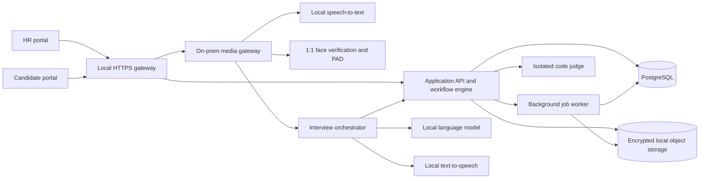

# SmartHire product architecture plan

**Planning baseline:** India-first, on-premises installation, fully functional without internet access, paid APIs, subscriptions, telemetry, license servers, or runtime downloads. The product must ship with all required models, voices, fonts, and assets. This is a proposed design, not a claim that the current prototype already meets these requirements.

## 1. Product goal and first-release boundary

SmartHire gives an HR team one system to configure a role, receive applications, screen resumes, run aptitude and coding assessments, conduct a live face-to-face AI interview, verify that the invited candidate is present, and make a documented human hiring decision. Candidates use a separate, accessible portal. Both portals are served by the same on-premises installation.

The first release serves candidates on the organization's LAN or at an on-site assessment station. An air-gapped installation cannot serve candidates over the public internet. Remote access through an organization-operated VPN or exposed gateway would be a separately reviewed deployment mode, with different network and threat assumptions. A same-PC workstation mode uses `localhost`; LAN mode needs a trusted internal HTTPS certificate so browser camera/microphone access works.

The product must never infer hiring suitability from facial expression, emotion, gaze, accent, appearance, or perceived confidence. Face processing is limited to identity and presence checks. Interview scoring uses job-relevant answer content and explicit rubrics, with human review and a way to correct errors.

## 2. User journeys

### Recruiter / administrator

1. Sign in through on-premises identity management; create a job and assessment blueprint.
2. Set required and preferred skills, location, shift, education and certificate rules, weightage, and interview rubric.
3. Set aptitude and coding difficulty mix with sliders, duration, question count, permitted languages, and accommodations. Preview an equivalent test form before publishing.
4. Invite candidates with expiring, single-use links or an on-site QR code.
5. Review resume evidence and resolve missing data; inspect test integrity and identity flags separately from scores.
6. Compare like-for-like candidates, read answer transcripts and source evidence, override incorrect extraction with a recorded reason, and record the final human decision.

### Candidate

1. Open an invite, read a clear privacy notice, and provide only the consent needed for the chosen verification path.
2. Upload a resume and confirm location, shift, education, certificates, accessibility needs, and a camera/microphone check.
3. Enroll a reference face through an HR-verified process or use a supervised identity alternative. A selfie alone does not establish legal identity.
4. Complete aptitude and coding tests with pause/recovery rules set by the recruiter.
5. Start the face-to-face AI interview: camera preview, AI avatar, spoken questions, real-time captions, spoken or typed answers, progress, and clear recording status.
6. Review the transcript, correct speech-to-text errors, and submit the interview.

## 3. Logical architecture

**Deployment units, not a microservice for every feature:**

| Unit | Responsibility | Initial implementation choice |
|---|---|---|
| Web bundle | HR and candidate portals, accessible motion graphics | React + TypeScript, compiled assets served locally; no CDN |
| Application API | Authentication, jobs, candidates, workflow, scoring, reporting, audit | Python ASGI modular monolith (FastAPI is a candidate; final framework choice after a spike) |
| Media/inference worker | WebRTC media, STT, live conversation, TTS, video verification | Separate process to isolate model failures and GPU memory |
| Code judge | Compile/run solutions and grade hidden cases | Windows AppContainer plus Job Objects for a Windows host, or isolated Linux runner for a Linux host; neither path ships without an escape test |
| Data | Transactions, score versions, consent, audit, model metadata | PostgreSQL plus encrypted local object storage |
| Background worker | OCR, parsing, report export, retention tasks | Database-backed job queue and outbox for first release |

Use a single signed offline installer that starts and checks all local services. A Windows installation exposes `SmartHire.exe` and `START_SMARTHIRE.cmd`; either starts the same local supervisor and opens the browser. A Linux server installation uses one `smarthire start` command or auto-starts as a service. Hardware profiles should be explicit: CPU-only assessment mode, and GPU interview mode with a benchmarked concurrent-session limit. No runtime model downloads.

## 4. Domain model and workflow contracts

Core records: `Organization`, `User`, `Role`, `Job`, `AssessmentBlueprint`, `Candidate`, `Application`, `ConsentReceipt`, `ResumeEvidence`, `FaceEnrollment`, `VerificationAttempt`, `TestForm`, `TestAttempt`, `CodeSubmission`, `InterviewSession`, `TranscriptTurn`, `Scorecard`, `ReviewDecision`, `AuditEvent`, and `ModelVersion`.

Every scorecard stores the job blueprint version, scoring rubric version, model version, inputs used, evidence references, missing-data status, assessor edits, timestamps, and reviewer identity. Candidate-facing answers and recruiter reviews are separate from biometric templates. State transitions are server-enforced:

`invited -> consented -> enrolled/alternative_verified -> screened -> testing -> interviewing -> awaiting_review -> reviewed -> closed`

Retries, interrupted sessions, accommodations, and failed identity checks have explicit transition paths. A process restart must not lose a test or interview. Session events are persisted before the next question is sent.

## 5. Phase 1: explainable screening

- Keep the current six configurable criteria as the starting rubric: skills 45, experience 10, education 15, certificates 10, location 10, shift 10. Allow job-specific weights that sum to 100.
- Parse PDFs and DOCX locally; use OCR for scans in the background worker. Present extracted fields with their source spans so a candidate or recruiter can correct them.
- Separate **evidence** from **preference**. Resume text may suggest a location, but shift willingness and relocation are confirmed directly by the candidate.
- Allow equivalent degrees and certificate aliases with recruiter-approved mappings; verify expiry where the certificate is a hard requirement.
- Show `meets`, `does not meet`, or `needs review` for each mandatory criterion. Missing information does not silently become a rejection.
- A score is provisional until required data is confirmed. No automatic rejection based on the numeric score alone.

## 6. Phase 2: difficulty controls and valid comparisons

The recruiter sees separate sliders for **aptitude difficulty** and **coding difficulty**, with a preview of the question mix. For example, a 3/5 aptitude setting might target 25% easy, 50% medium, and 25% hard. The product stores the exact blueprint at publication time; changing a slider creates a new version and never changes an in-progress test.

| Control | Recruiter can set | Server enforces |
|---|---|---|
| Aptitude | Difficulty 1–5, question count, time, section weights | Role tags, reviewed question bank, deterministic seed, answer-key secrecy, equivalent forms |
| Coding | Difficulty 1–5, problems, languages, time/memory limits | Hidden tests, isolated execution, pinned compiler/runtime versions |
| Interview | Depth 1–5, topics, maximum follow-ups and duration | Same published rubric and question coverage for candidates in a cohort |
| Accessibility | Extra time, captions, keyboard controls, alternative identity path | Accommodation is applied without altering the underlying skill rubric |

Raw percentages from different difficulty settings are not directly comparable. First-release ranking compares candidates only within the same published blueprint or uses a separately validated normalization method. Adaptive testing can follow later, once item difficulty is calibrated with real performance data. Question banks need authoring, review, versioning, leakage controls, and retirement rules.

The current `subprocess` coding runner in `unified/app.py` is a prototype only. Public candidate code must execute in an isolated worker with no access to candidate data, secrets, host files, or any network. On Windows, an AppContainer or less-privileged AppContainer supplies file/network isolation while a Job Object limits the process tree and resources. On Linux, use a dedicated isolated runner. Treat both as design candidates until a security spike and adversarial review prove the intended boundary; if the boundary is not ready, public coding submissions cannot be enabled.

## 7. Phase 3: face-to-face AI interview

**Media path:** Candidate browser captures camera and microphone with `getUserMedia`; WebRTC carries media to a local media gateway; WebSocket carries controls, captions, status, and question events. ICE configuration contains no public STUN/TURN service; internal TURN is packaged only for supported private-network topologies. The gateway feeds voice activity detection and local STT. An interview orchestrator chooses the next rubric-grounded question or bounded follow-up, calls a locally packaged LLM, and passes approved text to local TTS. The browser renders the AI avatar, synchronized captions, transcript, and speaking state.

**Conversation rules:** The LLM cannot invent job criteria, ask about protected or irrelevant personal topics, promise employment, or change scoring weights. It receives the published job rubric and a short, redacted conversation context. Question selection is constrained to the approved bank and topic coverage. A deterministic fallback asks the next approved question when inference is slow or unavailable. Candidates can ask for repetition, switch to text, correct STT, or request a human interview.

**Scoring:** Use structured, job-specific rubrics for answer content, evidence, and problem solving. LLM suggestions are evidence-linked and reviewable, not final decisions. Version and evaluate prompt, model, rubric, and transcript together. Do not score facial emotion, eye contact, perceived honesty, attractiveness, accent, or voice characteristics. Clearly mark transcription uncertainty and incomplete answers.

**Latency target:** On an approved GPU hardware profile, target p95 under 4 seconds from end of candidate speech to start of AI speech for one session, with graceful fallback to text. This is a proposed release target requiring measurement, not a current performance claim.

## 8. Face recognition and candidate verification

Verification is **1:1**: compare the live candidate only against that candidate's enrolled reference. Do not search a gallery for identity. Enrollment must be linked to an HR-supervised or otherwise trusted identity check; comparing two self-supplied photos proves only consistency between photos.

1. Show a separate, plain-language biometric notice and record consent/alternative choice.
2. Capture a quality-checked reference image or template at enrollment; encrypt it separately from resumes and interview data.
3. At interview start, verify camera integrity signals, image quality, one face, local presentation attack detection (PAD), and 1:1 similarity.
4. Use randomized active prompts only when needed, along with passive PAD. Blink detection by itself is insufficient against replay/injection attacks.
5. Recheck presence at selected points, log confidence and capture quality, and route ambiguous or failed checks to a trained human reviewer. No automatic candidate rejection.
6. Offer a supervised identity path when face verification is inaccessible, declined, or inconclusive.

The existing SFace/Tkinter app is a useful prototype reference but should not be imported as the production verifier. Select a commercially licensable face model and PAD implementation only after independent testing with the intended cameras, lighting, spoof materials, and Indian candidate population. Fix a threshold from validation data, report false match and false non-match rates by relevant groups, and retest after model updates. NIST documents both remote-media injection risks and demographic variation in face recognition; a face match alone does not prove that video came from a genuine camera. [NIST identity proofing](https://pages.nist.gov/800-63-4/sp800-63a.html), [NIST face evaluation](https://pages.nist.gov/frvt/html/frvt_demographics.html).

## 9. Motion and interaction design

- Use bundled SVG/CSS/Canvas or locally packaged animation assets for an AI avatar, audio waveform, question transitions, progress ring, verification cues, and final report reveal.
- Keep motion functional: speaking/listening/thinking states, audio-level feedback, camera quality prompts, and stage completion. Avoid animation that resembles a face-verification verdict before a result is confirmed.
- Use a motion budget: mostly compositor-friendly opacity/transform, 60 fps target on approved client hardware, pause animations when offscreen, and never let animation delay controls or captions.
- Respect `prefers-reduced-motion`, keyboard navigation, screen readers, high contrast, and captions. Provide a static AI avatar and text-only path.
- Run usability sessions with HR staff and candidates before freezing the design system.

## 10. Security, privacy, and governance

An on-premises install still needs internal HTTPS, role-based access, candidate token expiry, CSRF protection, input validation, encrypted storage and backups, key rotation, audit logs, and signed offline updates. Define retention separately for resumes, transcripts, recordings, biometric templates, and logs. Make deletion, access export, consent withdrawal, and incident response operational workflows. Avoid storing full interview video by default; retain only consented evidence needed for a review window.

For India, the DPDP Act and notified Rules make notice, lawful processing basis, security safeguards, access control, logs, backup, and erasure design requirements to resolve with counsel and each customer. The Rules have phased commencement dates, so the release checklist should verify which provisions are in force at launch. [DPDP Act](https://www.meity.gov.in/static/uploads/2024/02/Digital-Personal-Data-Protection-Act-2023.pdf), [DPDP Rules](https://www.meity.gov.in/static/uploads/2025/11/53450e6e5dc0bfa85ebd78686cadad39.pdf).

For hiring quality, run recurring validation of score agreement with trained HR reviewers, adverse-impact checks where lawful data is available, accessibility tests, STT error analysis for Indian English and regional accents, and appeal/correction workflows. Models and weights must not silently change in a live job. Use the NIST AI RMF as a voluntary risk-management reference. [NIST AI RMF](https://airc.nist.gov/airmf-resources/).

## 11. Packaging and operations

- **Windows first:** ship a versioned one-folder installer for Windows 11 x64 containing the application runtime, local PostgreSQL, model/voice weights, code-runner binaries, fonts, and web assets. `SmartHire.exe` is a small supervisor/launcher, not a giant self-extracting model archive. `START_SMARTHIRE.cmd` invokes the same supervisor. The launcher owns child-process start/stop, port selection, health checks, logs, and browser opening. A repeat start focuses the existing instance instead of starting duplicates. The first run is a setup wizard; subsequent starts require one click or one command. PyInstaller one-folder packaging is a candidate; its commercial bundling exception still requires compliance with each bundled dependency's licence. [PyInstaller licensing](https://pyinstaller.org/en/stable/license.html), [PyInstaller usage](https://pyinstaller.org/en/stable/usage.html).
- **Linux server option:** the same application is distributed as an offline package with a single service-manager command and optional automatic boot startup. It uses a Linux-isolated code judge. Avoid a Docker Desktop dependency for the Windows package.
- The setup wizard checks CPU/GPU/RAM/disk, creates local secrets, configures localhost or internal HTTPS, sets the administrator, validates camera/mic permissions, checks every bundled model hash, and runs a sample end-to-end health check. LAN certificates require a one-time customer IT trust step; a desktop launcher cannot silently establish browser trust on other machines.
- A startup self-test must fail clearly if a model file, database, microphone permission, code sandbox, or required port is unavailable. There is no silent cloud fallback. The app remains usable for unaffected stages where safe.
- Provide offline backups, restore drill, migration rollback, capacity dashboard, disk alerts, model hashes, and a signed update package with release notes.
- Sign release manifests and update packages with a self-managed offline Ed25519 release key and verify them in the launcher. This requires no paid certificate authority. Windows Authenticode signing may improve operating-system trust but may involve certificate cost; it is optional for operation. Customer IT can explicitly trust an internal signing certificate if desired.
- Provide a CPU-only mode for screening/tests and a GPU profile for real-time interviews. Refuse to schedule more simultaneous interviews than the benchmarked capacity.
- Keep the current Python/SQLite launcher as a development demo only. The production Windows package must prove service supervision, database migration, and a safe code-execution boundary before release.

### Offline and zero-fee acceptance test

Run the final packaged installer on a clean supported machine with network interfaces disabled. From installation through job creation, PDF parsing/OCR, face enrollment and verification, aptitude, code grading, spoken interview, report export, backup, restart, and offline update, no operation may require DNS, a cloud API, an account, or a license server. Capture outbound network attempts during the test. Bundle all JavaScript, fonts, animation assets, model weights, and voices locally. A local LAN connection between candidate device and on-prem server is permitted in LAN mode; an internet connection is not.

“Free” here means no software usage fees, subscriptions, or required paid APIs. Hardware, electricity, and an existing Windows licence still have costs. The optional Linux package permits a fully free operating-system stack. Before selecting and shipping any model, voice, font, animation, or binary, record its exact version, source, licence, commercial redistribution rights, attribution obligations, model card, and SHA-256 hash in a software/model bill of materials. A free runtime does not imply that its model weights or voice data may be redistributed commercially. Reject components without clear rights and pin approved artefacts in the offline installer.

## 12. Delivery sequence and release gates

| Stage | Deliverable | Exit gate |
|---|---|---|
| A. Product foundation | Accounts, organizations, role/job versions, migration to PostgreSQL, audit and consent records | End-to-end workflow survives restarts and restores |
| B. Assessments | Question authoring, difficulty sliders, equivalent forms, isolated code judge | No host escape in reviewed threat model; comparable cohorts and reproducible scoring |
| C. Live interview | WebRTC, local STT/LLM/TTS, avatar/captions, recovery and text fallback | Latency, transcription, accessibility, and failure-recovery targets met on approved hardware |
| D. Identity | Trusted enrollment, 1:1 match, PAD, manual alternative, retention | Independent spoof and demographic performance evaluation; human review works |
| E. Productization | Windows `SmartHire.exe` and `START_SMARTHIRE.cmd`, optional Linux installer, security testing, documentation, backup/update process | Air-gapped installation test, zero-fee licence audit, pilot at two HR teams, incident drill, privacy review, operational acceptance |

No stage is marked shippable based solely on feature completion. The first customer release needs a security review, legal/privacy review for India, model and fairness evaluation, accessibility audit, observed performance on specified hardware, and a supervised pilot.

## 13. Decisions to settle before implementation

1. Approved server hardware and maximum simultaneous interviews. This determines model size, latency, and cost.
2. Exact identity-enrollment authority: HR-supervised document check, in-person enrollment, or a customer-owned identity source.
3. Whether any interview media is retained, for how long, and who may access it.
4. Candidate language support for the first release; STT, TTS, question bank, and evaluation must support the same languages.
5. Customer IT constraints: Windows 11 x64 and/or Linux, internal CA, local directory integration, permitted LAN topology, and whether virtualization is allowed.

These decisions do not block architecture work; they control the final model, infrastructure, and release benchmarks.
